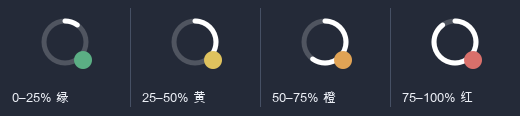

# fish

一个 macOS 原生的下班倒数计时器（摸鱼专用 🐟）。

常驻菜单栏 + 永远置顶的悬浮小窗。纯 Swift / SwiftUI + AppKit，离线运行、不联网、不上传任何数据。



## 快速开始

```bash
git clone https://github.com/Ryosnow/fish.git
cd fish/mac
./build.sh
```

构建产物为仓库根目录的 `下班倒计时.app`，双击即可运行（已 ad-hoc 签名）。

**要求**：macOS 13+，Xcode 或 Command Line Tools（`swiftc`、`iconutil`、`sips`、`codesign`、`plutil`）。

## 功能

- **菜单栏进度环**（默认）：14pt 细圆环按今日净工作进度填充，右下角一颗四段纯色色点——0–25% 绿 `#5BAE84`、25–50% 黄 `#DFC25E`、50–75% 橙 `#E0A355`、75–100% 红 `#D9706B`。不显示任何数字；也可切到「精简」（`2:32`）或「完整」（`🕕 02:32:30`）文字档
- **悬浮窗**：`NSFloatingWindowLevel` + 跨所有桌面空间，全屏应用下也可见；可拖动、位置自动记住；大号倒计时 + 进度条 + 摸鱼语录
- **四种状态**：上班前 / 工作中 / 已下班（显示「已下班 X 小时」）/ 休息日（显示距下次上班还有多久）
- **作息**：上下班时间、周一至周日任意工作日、**跨零点班次**（22:00 → 次日 06:00）、午休不计入进度、**节假日/调休按日期覆盖**（补班 / 放假）
- **配色**：5 套低饱和预设（默认雾蓝）+ 跟随系统强调色 + 自定义取色器
- **隐私**：悬浮窗右上角 `−` 收缩成不显示数字的小图标；**⌃⌥⌘H** 一键完全隐身（悬浮窗消失、菜单栏只剩极淡空心环），再按恢复；另有「隐身 30 分钟」自动恢复
- 登录时启动、下班提示音、深浅主题、透明度

## 操作

| 操作 | 说明 |
| --- | --- |
| 左键点菜单栏 | 打开详情与设置面板 |
| 右键点菜单栏 / 悬浮窗 | 快捷菜单（收缩、隐身、紧凑模式等） |
| `⌃⌥⌘H` | 一键隐身 / 恢复（系统级热键，无需辅助功能权限） |
| 拖动悬浮窗 | 移动位置，重启后保留 |
| 悬浮窗右上角 `−` | 收缩成小图标，点一下展开 |

## 目录

| 路径 | 说明 |
| --- | --- |
| `mac/Sources/main.swift` | 全部逻辑：状态计算、菜单栏、悬浮窗、设置、配色、隐身 |
| `mac/Info.plist` | 应用配置（`LSUIElement`，不显示 Dock 图标） |
| `mac/build.sh` | 生成图标 → 编译 → 打包 → ad-hoc 签名 → 自检 |
| `mac/make_icon.py` | 纯 Python 标准库生成 App 图标 |
| `docs/plans/2026-11-10-菜单栏进度环-design.md` | 进度环与色点的设计文档 |
| `docs/进度环色点示意.png` | 四段色点预览 |

## 自检

`build.sh` 会自动运行三项：

```bash
./下班倒计时.app/Contents/MacOS/OffWorkCountdown --version-check
./下班倒计时.app/Contents/MacOS/OffWorkCountdown --hotkey-check
./下班倒计时.app/Contents/MacOS/OffWorkCountdown --selftest   # 33 项纯函数回归测试
```

`--selftest` 覆盖工作日 / 休息日 / 跨零点 / 午休 / 调休 / 跨周末 / 周五下班 / 菜单栏文案 / 进度环形态 / 色点四档与边界 / 旧配置兼容等，失败直接退出非 0。

## 备注

- 设置保存在 `UserDefaults`（`com.rumor.offwork-countdown`），改动即时生效；新增字段对旧配置向后兼容
- 应用不联网，**法定节假日与调休日期需在设置里逐日手动标记**（不内置未经核实的数据）
- 移动 `.app` 后请把「登录时启动」关掉再打开一次以刷新路径
- 早期网页版未纳入本仓库
