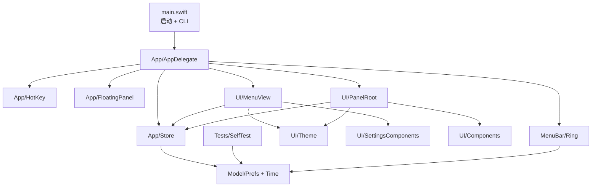

# 下班倒计时 — 项目架构

> 版本 1.0 · 更新 2026-11-11 · 面向后续维护与二次开发
>
> 本文描述「是什么、怎么组织、为什么这么设计」。构建与逐模块实现细节见 [README.md](README.md)，模块级文档见 [docs/](docs/)。

---

## 1. 系统定位与约束

一个 **macOS 菜单栏常驻的小工具**：在菜单栏显示下班倒计时，可选桌面悬浮窗，左键弹出设置面板，全局热键一键隐身。

| 约束 | 值 |
| --- | --- |
| 应用形态 | `LSUIElement = true`（无 Dock 图标、无主窗口、不可成为激活 App） |
| UI 宿主 | 4 个相互独立的宿主：菜单栏项、Popover、悬浮窗、右键菜单 |
| 进程 / 数据 | 单进程、纯本地、无网络请求、无数据库、无第三方框架 |
| 持久化 | `UserDefaults` 单个 JSON 字符串 + 窗口位置 |
| 目标平台 | macOS 13.0+ / arm64 / Swift 5（`xcrun swiftc` 直接编译） |
| 签名 | ad-hoc（`codesign --sign - --identifier com.rumor.offwork-countdown`） |
| Bundle | `CFBundleName` 下班倒计时，`CFBundleExecutable` OffWorkCountdown，版本 1.0 |

**不做什么**：不联网、不同步、不收集数据、不提供自动更新、不做工时统计报表。这些不是遗漏，是保持「轻量小工具」定位的主动取舍。

---

## 2. 技术栈

| 层 | 框架 / 工具 | 用途 |
| --- | --- | --- |
| 声明式视图 | SwiftUI | `MenuView`、`PanelRoot` 及全部 UI 组件 |
| 系统宿主 | AppKit | `NSStatusItem` / `NSStatusBarButton` / `NSPopover` / `NSPanel` / `NSMenu` |
| 自绘 | AppKit + CoreGraphics | `RingStatusView`（`NSView` + `CGContext` 画进度环） |
| 状态 | Combine | `ObservableObject` / `@Published` / `sink` |
| 全局热键 | Carbon | `RegisterEventHotKey`（⌃⌥⌘H，无需辅助功能权限） |
| 登录自启 | ServiceManagement | `SMAppService.mainApp`，失败回退 LaunchAgent plist |
| 构建 | bash + python3 | [build.sh](build.sh) / [make_icon.py](make_icon.py) / `iconutil` / `codesign` |

SwiftUI 与 AppKit 混用是**有意为之**：视图内容用 SwiftUI 写，但菜单栏项、Popover、无边框悬浮窗、全局热键只有 AppKit / Carbon 能提供。

---

## 3. 模块分层

```
OffWorkCountdown/
├── Sources/
│   ├── main.swift                  启动入口 + 3 个 CLI 自检分支（唯一含顶层代码的文件）
│   ├── App/
│   │   ├── AppDelegate.swift       生命周期、四大宿主组装、设置联动、右键菜单
│   │   ├── Store.swift             数据仓库：偏好发布、状态派生、登录自启同步
│   │   ├── FloatingPanel.swift     无边框 NSPanel
│   │   └── HotKey.swift            Carbon 全局热键（含 3 个文件私有全局变量）
│   ├── Model/
│   │   ├── Prefs.swift             偏好模型、向后兼容解码、校验
│   │   └── Time.swift              时间工具、状态模型、语录池、班次与进度纯计算
│   ├── MenuBar/
│   │   └── Ring.swift              进度环自绘视图 + 4 个绘制参数纯函数
│   ├── UI/
│   │   ├── Theme.swift             语义色、动态深浅配色、主题映射
│   │   ├── Components.swift         DigitsText / ProgressBar
│   │   ├── PanelRoot.swift          悬浮窗内容（完整态 / 收缩态 / 右键菜单）
│   │   ├── SettingsComponents.swift CardSeparator / SettingsCard / CheckRow
│   │   └── MenuView.swift           设置面板（3 个 Tab）
│   └── Tests/
│       └── SelfTest.swift           38 项纯函数回归自测
├── Info.plist
├── make_icon.py
├── build.sh
├── README.md
├── ARCHITECTURE.md                 ← 本文
└── docs/                           模块级项目文档（进度环 / 界面与可访问性 / 项目结构）
```



### 依赖规则

- **Model 层是纯的**：`Model/Prefs.swift` 与 `Model/Time.swift` 只 `import Foundation`，不依赖任何 UI 框架；时间计算全部是可单测的纯函数。
- **UI 层不碰宿主**：SwiftUI 视图只通过 `@EnvironmentObject var store` 读写数据，不直接创建 / 操作 `NSWindow` / `NSStatusItem`。
- **AppDelegate 是唯一组装者**：创建四大宿主、绑定 `$prefs` sink、注册热键、监听通知，其他模块不互相持有。
- **MenuBar/Ring.swift 只服务菜单栏**：被 `AppDelegate` 独占使用。
- **Tests/SelfTest.swift 只依赖 Model 纯函数**（另外用 `NSFont` 测百分比文字宽度，因此额外 `import AppKit`）。
- 顶层 `private` 声明与使用方同文件：`QUOTES` 与 `workingQuote` / `computeState` 同在 `Model/Time.swift`；3 个热键全局变量与 `registerGlobalHotKey` 同在 `App/HotKey.swift`。

---

## 4. 构建与运行入口

`Sources/main.swift` 只有约 28 行，**只放顶层可执行代码**：

| 分支 | 作用 |
| --- | --- |
| `--version-check` | 打印版本与系统版本，验证可执行文件 / 动态库可加载 |
| `--hotkey-check` | 注册一次全局热键，检测是否被占用 |
| `--selftest` | 跑 `runSelfTest()` 的 38 项纯函数断言，失败退出非 0 |
| 默认 | `NSApplication.shared` → `AppDelegate` → `setActivationPolicy(.accessory)` → `app.run()` |

> **为什么入口这么瘦**：Swift 规定顶层可执行语句只能出现在 `main.swift`。旧版把 1798 行库代码和入口混在一起，全局变量按源码顺序初始化，`--selftest` 曾因 `QUOTES` 未初始化而 segfault。拆分后全局常量由编译器按需惰性初始化，该陷阱消失。详见 [项目结构](docs/项目结构.md)。

[build.sh](build.sh) 四步：

1. `make_icon.py` 生成 1024px PNG → `sips` 切 10 个尺寸 → `iconutil` 打包 `AppIcon.icns`
2. `find Sources -name '*.swift' | sort` 收集**全部** Swift 文件 → `xcrun swiftc -O -target arm64-apple-macosx13.0` 编译到 `.app/Contents/MacOS/`
3. 复制 `Info.plist` → `plutil -lint` → `codesign --force --sign -`
4. `codesign -v` + 依次跑 3 个 CLI 自检

产物：`../下班倒计时.app`（与本源码目录同级）。`main.swift` 由**文件名**被识别为入口，与其他文件的传入顺序无关。

---

## 5. 领域模型

### 5.1 `Prefs`（`Model/Prefs.swift`）

唯一持久化结构，`Codable`，22 个字段。`init(from:)` 对每个字段用 `decodeIfPresent`，**旧配置缺字段不报错**；`validated()` 做范围收敛。

| 分组 | 字段 |
| --- | --- |
| 作息 | `start` / `end`（HH:mm）、`workdays`（0=日…6=六）、`breakEnabled` / `breakStart` / `breakEnd`、`dayOverrides`（`yyyy-MM-dd` → 1 补班 / 0 放假） |
| 悬浮窗 | `showPanel`、`compact`、`alwaysOnTop`、`panelOpacity`、`panelOrigin`、`collapsed` |
| 菜单栏 | `menuStyle`（0 完整 / 1 精简 / 2 进度环）、`menuPercent` |
| 外观 | `theme`（0 跟随 / 1 深 / 2 浅） |
| 系统 | `launchAtLogin`、`sound` |
| 隐身 | `stealth`、`stealthUntil` |
| **已废弃** | `palette`、`customHex` — 界面已移除配色自定义，字段保留仅为兼容旧 JSON，不再被 UI 读写 |

### 5.2 状态类型

| 类型 | 含义 |
| --- | --- |
| `Phase` | `before`（上班前）/ `working`（工作中）/ `off`（已下班）/ `rest`（休息日） |
| `Shift` | 一次班次的起止区间，由 `shifts(around:)` 生成 |
| `CountdownState` | 视图唯一数据源：`title` / `digits` / `label` / `sub` / `quote` / `progress` / `menu` / `menuShort` |

### 5.3 时间线（全部纯函数，`Model/Time.swift`）

- `shifts(around:)`：生成前后班次区间；`end <= start` 视为**跨零点**（次日下班）
- `isWorkday()`：先查 `dayOverrides`，未覆盖再回落到每周 `workdays`
- `nextWorkStart()`：向后最多 14 天找下次上班（解决周五下班后跨周末的倒数）
- `workdaysThisWeek()`：本周工时
- `computeState(now, prefs)`：聚合出 `CountdownState`；午休开启时从净工时中扣除
- `workingQuote()`：按剩余时长从 `QUOTES` 池挑文案（纯按日期取模，稳定不随机）
- `statusIconName()`：文字档 / 降级路径用的 SF Symbol 三态映射

### 5.4 进度环绘制参数（`MenuBar/Ring.swift`）

| 函数 | 输出 |
| --- | --- |
| `ringSegments(phase:progress:isStealth:)` | 底环透明度 / 进度 / 虚线 / 实色弧 / 中心点 |
| `ringDotColor(phase:progress:isStealth:)` | 四段纯色：0–25% 绿 / 25–50% 黄 / 50–75% 橙 / 75–100% 正红；仅「等下班」显示 |
| `ringDotGeometry(ringCenter:ringRadius:)` | 色点位置与半径（压住环右下角一小段） |
| `menuPercentText(progress:isStealth:)` | `41%` 文案，隐身时 `nil`，`100%` 右对齐不越界 |

把绘制参数抽成纯数据，是为了让 38 项自测能覆盖形态与边界，而不必渲染视图。

---

## 6. 数据流

```mermaid
graph LR
    T[Timer 0.5s] -->|tick| Now[Store.now @Published]
    Now --> State[Store.state<br/>computeState 派生]
    State --> UI[SwiftUI 视图重算]
    W[写入 prefs] -->|didSet| Save[save → UserDefaults JSON]
    W -->|@Published sink| Apply[AppDelegate.applyPrefs]
    Apply --> Rebuild[重建菜单栏 / 面板可见性 / 外观]
    Apply --> Sync[登录自启状态同步]
```

- **读**：视图通过 `@EnvironmentObject` 拿 `Store`，`store.state` 是每帧派生的计算属性，不缓存。
- **写**：目前有两条路径 —— `Store` 方法（`setStart` / `setEnd` / `toggleDay` / `setLaunchAtLogin` / `syncLaunchAtLogin`）与视图里直接写 `store.prefs.xxx`（约 30 处）。**这是已知的待统一点**（见 §14）。
- **持久化**：`prefs` 的 `didSet` 直接 `save()` 写 `UserDefaults`（key `com.rumor.offwork-countdown.prefs.v1`），改动即时生效、重启保留。
- **菜单栏环**：`updateStatusItem()` 比较上次值，仅变化时 `needsDisplay`，避免 0.5s 无意义重绘。
- **悬浮窗高度**：`resizePanelToFit()` 用 `NSHostingView.fittingSize` 重算，配合 `@ScaledMetric` 适配 Dynamic Type。

---

## 7. 启动与生命周期

`AppDelegate.applicationDidFinishLaunching` 的顺序是有依赖的，不要随意调整：

| # | 步骤 | 说明 |
| --- | --- | --- |
| 1 | 单实例检测 | 同名 bundle 已运行则激活对方并自退，避免菜单栏出现多个图标 |
| 2 | 隐身状态清理 | 手动 `stealth` 不跨重启；`stealthUntil`（临时隐身）按到期时间保留 |
| 3 | `syncLaunchAtLogin()` | 读 `SMAppService.mainApp.status` + LaunchAgent plist，校正开关 |
| 4 | `setActivationPolicy(.accessory)` | 无 Dock 图标 |
| 5 | `buildContextMenu()` / `setupStatusItem()` / `setupPanel()` / `setupPopover()` | 组装四大宿主 |
| 6 | `$prefs.sink { applyPrefs }` | 偏好变化联动 |
| 7 | `Timer`（0.5s，`RunLoop.common`）+ 立即 `tick()` | 驱动倒计时 |
| 8 | `registerGlobalHotKey` | ⌃⌥⌘H，失败只记日志、不影响其他入口 |
| 9 | 通知监听 | `windowDidMove`（记位置）、`owOpenSettings`、`didChangeScreenParameters` |
| 10 | 延迟 0.4s / 1.2s `resizePanelToFit()` | 等 SwiftUI 首次布局完成后精修窗口尺寸（幂等） |

`applyPrefs` 负责：重建状态栏（档位 / 百分比开关变化时）、`panel.setIsVisible(p.showPanel && !isStealth)`、隐身时关闭已打开的 Popover、主题与透明度同步。

`ensurePanelOnScreen()` 在屏幕参数变化时校验窗口位置是否仍在任一可见屏幕内，避免拔掉外接屏后窗口跑丢。

---

## 8. 四个 UI 宿主

| 宿主 | AppKit 类型 | 内容 | 层级 / 特性 | 交互 |
| --- | --- | --- | --- | --- |
| 菜单栏项 | `NSStatusItem` → `NSStatusBarButton` | `RingStatusView` 作为 button 子视图 | `layer 25`，常驻 | 左键开 Popover，右键开 `NSMenu`，悬停显示详情 |
| 设置面板 | `NSPopover`（330×420） | `MenuView` | 瞬时、失焦自动关闭 | 3 个 Tab + 固定底栏 |
| 悬浮窗 | `NSPanel`（`FloatingPanel`） | `PanelRoot` | `.floating` / `.canJoinAllSpaces` / `.nonactivatingPanel` / `isMovableByWindowBackground` | 可拖动、右键菜单、可收缩成 46×30 |
| 右键菜单 | `NSMenu` | 系统菜单项 | 由 `buildContextMenu()` 构建 | 隐身 / 收缩 / 设置 / 退出 |

### 为什么用 `NSStatusBarButton` 而不是 `statusItem.view`

早期版本用已废弃的 `statusItem.view` 自绘，系统**完全不接管**高亮与点击反馈，只能自己仿颜色、圆角、透明度，怎么都对不齐相邻图标。现在：

- 系统 `NSStatusBarButton` 负责点击 / 高亮 / 菜单；
- `RingStatusView` 的 `hitTest` 返回 `nil`，鼠标事件穿透到 button，它只负责画内容；
- `NSPopoverDelegate.popoverDidShow/DidClose` 调 `button.highlight(true/false)` 保持面板打开期间的高亮；
- 若 button 创建失败，`ringUnavailable` 降级到 SF Symbol 三态图标档。

---

## 9. 设置面板结构

`MenuView` 按 **渐进式披露** 收敛成 3 个 Tab（避免一屏堆 14 个控件）：

| Tab | 内容 |
| --- | --- |
| 总览 | 大号倒计时、进度条 + 百分比、状态说明、快捷键提示 |
| 作息 | 上下班时间、工作日、午休、节假日 / 调休（`DisclosureGroup`） |
| 显示 | 悬浮窗 / 菜单栏 / 外观三张 `SettingsCard`；「高级」折叠收纳置顶、提示音、登录自启、收缩、隐身 30 分 |

- 分组标题在卡片外，卡片白底细边框 + `CardSeparator` 行间细线（Cursor 设置页风格）。
- 所有开关是 `CheckRow`（macOS 原生 `.toggleStyle(.checkbox)`，蓝色方块 + 标题 + 一行说明）。
- 色板 / 工作日按钮 / 迷你视图均用 `Button` + `.buttonStyle(.plain)`，带 `accessibilityLabel` / `accessibilityValue` / `.isSelected`，支持键盘与 VoiceOver。
- `Store.timeError` 统一在 Tab 栏下方渲染可关闭的错误横幅（任何 Tab 可见）。

---

## 10. 配色与主题

- `PanelColor`（`UI/Theme.swift`）：`background` 纯白 / 深色 `#1C1C1E`，`card` `#F5F5F7`，`secondary` `#6E6E73`；全部由 `appleColor(light:dark:)` 通过 `NSColor` dynamicProvider 提供深浅两套值。
- `paletteColor(_:)` 固定返回 `Color.primary`（近黑 / 深色近白）。数字、进度条、百分比、状态点全部**单色、无渐变**，界面不再提供配色自定义。
- `preferredScheme(theme)` 映射 0/1/2 到 `.none / .dark / .light`。
- 唯一彩色来自系统强调色（复选框选中态），由系统控制、自动适配。

---

## 11. 隐身与收缩

| 状态 | 字段 | 表现 |
| --- | --- | --- |
| 手动隐身 | `stealth = true` | 悬浮窗隐藏、Popover 关闭、菜单栏环降为极淡空心圈、文字档强制只留图标；**不跨重启** |
| 临时隐身 | `stealthUntil` 时间戳 | 同上，`tick()` 到期自动 `clearExpiredStealth()`；跨重启按时间判断 |
| 收缩 | `collapsed = true` | 悬浮窗变 46×30 的 `clock` + `plus` 小图标，完全不显示数字 |

`isStealth` 是派生属性：`prefs.stealth || (stealthUntil ?? 0) > 现在`。⌃⌥⌘H 切换手动隐身；隐身时点击菜单栏时钟图标也能恢复。

---

## 12. 持久化与兼容性

- 单一 key：`com.rumor.offwork-countdown.prefs.v1`，值为 `Prefs` 的 JSON。
- 新增字段一律走 `decodeIfPresent`，旧配置可平滑升级；`palette` / `customHex` 保留但不使用。
- 窗口位置 `panelOrigin` 单独记录，`windowDidMove` 更新；启动时与屏幕参数变化时由 `ensurePanelOnScreen()` 校验。
- 登录自启有两套落点：`SMAppService.mainApp`（优先）与 `~/Library/LaunchAgents/com.rumor.offwork-countdown.plist`（回退）。`syncLaunchAtLogin()` 任一启用即视为开，避免与「系统设置 → 通用 → 登录项」脱节。

---

## 13. 设计决策记录（摘要）

| 决策 | 原因 | 被否掉的替代 |
| --- | --- | --- |
| 用 `NSStatusBarButton` + 子视图 | 系统原生高亮 / 点击 / 菜单，无需自己仿 | 已废弃的 `statusItem.view` 自绘高亮 |
| 设置面板纯白底 + 分组卡片 | 统一 Cursor / macOS 系统设置观感，避免材质透出壁纸 | `.ultraThinMaterial` 半透明 |
| 复选框替代蓝色胶囊开关 | 用户偏好；与系统设置一致 | `.toggleStyle(.switch)` |
| 取消配色自定义 | 克制、减少维护面；固定黑白灰 | 7 色板 + 取色器 |
| 3 Tab + 分组卡片 | 渐进式披露，避免一屏堆满 | 单个长滚动列表 |
| 语义字体 + `@ScaledMetric` | 支持 Dynamic Type、去掉 <12pt 小字 | 写死 `.system(size:)` |
| `main.swift` 只放入口 | 根除全局变量按源码顺序初始化导致的 selftest segfault | 单文件 1798 行 |
| 一键 `build.sh` 直接 swiftc | 轻量、无需 Xcode / SwiftPM，产出可直接双击的 .app | Xcode 工程 / SwiftPM bundle |

模块级细节见 [docs/](docs/) 下三份项目文档。

---

## 14. 已知技术债与后续路线

按上轮代码结构评审的优先级，**本轮已完成第 1 项**：

- ✅ **1（高）**：拆分 `main.swift` + 改 `build.sh` 多文件编译
- ⬜ **2（中）**：`AppDelegate.swift`（384 行 / 28 方法）按 `extension` 拆成 StatusItem / Popover / Panel / Menu / Prefs 分组；修正失真的 MARK 分区名
- ⬜ **3（中）**：统一数据流 —— 视图只调 `Store` 方法，收敛那 30 处直接写 `prefs`；`timeError` 改名（实际只承载登录自启错误）；给废弃字段加 `deprecated` 说明
- ⬜ **4（低）**：加 `Package.swift` + `Tests/`，把 `SelfTest.swift` 移出产品二进制，支持 `swift test`

**明确不建议**：升级 Swift 6 / strict concurrency（AppKit 回调多、收益低）、引入第三方框架、把 AppKit 宿主强行 SwiftUI 化、加工时统计 / 图表（破坏「简洁小工具」定位）。

---

## 15. 相关文档与唯一可信源

项目共有 6 份文档，按**用途**分工，避免同一事实多处维护：

| 场景 | 唯一可信源 |
| --- | --- |
| 模块分层、数据流、生命周期、设计决策、技术债 | **本文（ARCHITECTURE.md）** |
| 构建命令、目录、逐模块实现要点、改默认值 | [README.md](README.md) |
| 模块级实现细节 | `docs/` 下 3 份项目文档（见 [docs/README.md](docs/README.md)） |
| 怎么用、快捷键、设置项含义 | [Obsidian 使用笔记](../下班倒数计时器.md) |
| 版本与时间线 | [CHANGELOG.md](CHANGELOG.md) |

| 文档 | 用途 |
| --- | --- |
| [README.md](README.md) | 构建方法、目录说明、逐模块实现要点、修改默认值 |
| [ARCHITECTURE.md](ARCHITECTURE.md) | 本文：整体架构与决策 |
| [下班倒数计时器.md](../下班倒数计时器.md) | Obsidian 使用笔记（面向用户） |
| [docs/README.md](docs/README.md) | 模块文档索引 |
| [docs/菜单栏进度环.md](docs/菜单栏进度环.md) | 环的形态、色点、百分比、系统高亮与降级 |
| [docs/界面与可访问性.md](docs/界面与可访问性.md) | 语义色、3 Tab、复选框、Dynamic Type、登录自启同步 |
| [docs/项目结构.md](docs/项目结构.md) | 14 文件分层、依赖规则、`main.swift` 规则、构建 |
